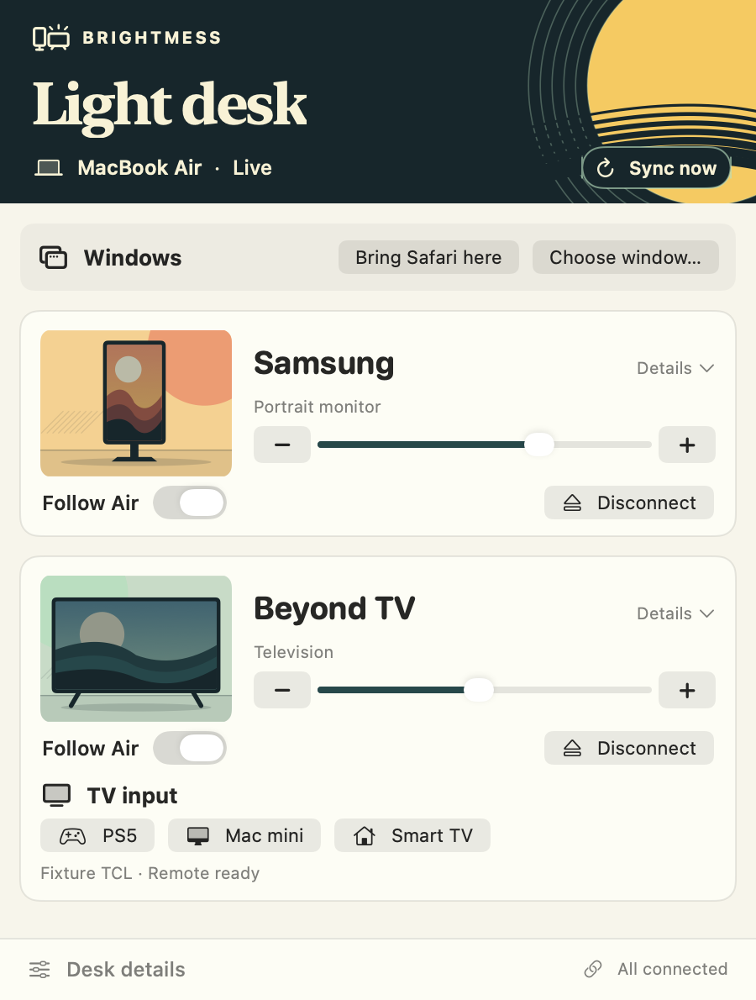

# BRIGHTMESS

BRIGHTMESS is a native macOS menu-bar app for a desk with more than one
screen. Its **Light desk** popover lets you follow a MacBook Air's brightness,
bring a Mac window to the monitor in front of you, or change what a paired TV
is showing. Moving a window never switches the TV input, and changing the TV
input never moves a window.

**On the tested 43-inch iFFALCON TCL G07:** click **Smart TV** for Home or
**Mac mini** to return directly to the Mac desktop on HDMI 3. Both were
confirmed on the TV itself. No USB debugging or TV-side app was needed.
The TV also identified HDMI 1, but the PS5 was off and switching to it was
not verified.

[Light desk controls](#menu-bar-controls) · [Install](#install) ·
[TCL setup and field notes](research/LIGHT-DESK-0.9.md#verified-return-to-hdmi-3-over-wi-fi) ·
[Release history](CHANGELOG.md)

## Menu-bar controls

Click the paired-screen menu-bar icon to open **Light desk** (Mini 0.9.0,
build 10). Each illustration follows its screen's applied brightness. Click
the artwork or **Details** for exact readings and calibration. This release
does not require an update to an existing 0.8 Air helper.



**Move windows:** Open Light desk on the destination monitor. **Bring [app] here**
moves the window you were using; **Choose window…** lists other eligible windows
by app, title and screen. This works without changing the TV input. In **Desk
details → Move window**, record an optional shortcut to send the focused window
to the other display. Allow Accessibility for the Mini app. True full-screen
windows must exit full screen first. Screen Recording is not needed.

**Switch TV inputs:** With the Mini and TV on the same LAN, choose **Pair
TV** on the TV card, select the TV, and enter its on-screen code into
BRIGHTMESS. Allow Local Network discovery if macOS asks. For a known input
ID, open **Set up → Configure HDMI fallback…**, enter the **full** ID for
that port, turn **uses input chooser** off for that button, and save.
On our G07, the TV's MagiConnect service supplied the ID over Wi-Fi; the
already-paired Android TV remote connection sent the input link. Automatic
discovery of port IDs is **not** part of build 10. A button with an ellipsis
requests the TV's input menu instead; this TCL ignored that request. See the
[tested mapping](research/LIGHT-DESK-0.9.md#verified-return-to-hdmi-3-over-wi-fi)
before trying any fallback. **Command sent** is not readback of the active
input, and commands are never queued for an offline TV.

The panel provides:

- an independent brightness slider and **− / +** buttons for each connected display; unlike keyboard keys, these buttons adjust only that screen;
- **Follow Air** per display; dragging a slider changes only that display
  without disabling automatic following; an explicit off switch stays manual;
- **Disconnect / Reconnect** per display;
- **Reconnect all** when there is a disconnected screen; the last connected screen cannot be disconnected;
- **Off / Adaptive / Manual white balance**, strength, trim and calibration under each screen’s **Details**;
- automatic per-screen learning, Undo last match and confirmed Reset calibration;
- Magic Keyboard brightness keys (Accessibility permission required);
- **Desk details** for source readings, keyboard status, re-detection, and the receiver log;
- source status for MacBook Air or solar fallback;
- on-demand Air sync and receiver-log access.

Automatic updates never overwrite a display left in manual mode. Re-enabling
**Follow Air** applies the current source value immediately.

## Current two-display behavior

This machine has been probed per display rather than treating every DDC service
as one monitor:

| Display | Stable identity | Brightness path | Displayed reading | macOS layout action |
|---|---|---|---|---|
| Samsung `LU28R55` (portrait) | EDID `4C2D1610-…` | Targeted hardware DDC write | `Last set` because this unit returns an invalid DDC read stream | Disconnect/reconnect |
| iFFALCON TCL 43-inch 4K (`Beyond TV` in macOS) | EDID `63185128-…` | Per-screen software dimming; DDC read/write rejected | `Software live` | Disconnect/reconnect |

The distinction is deliberate. A cached command is never presented as a live
hardware read. The TV's software value is live because BRIGHTMESS owns
the shade opacity. The Samsung's hardware backlight target is labeled **Last
set** because the monitor does not provide a checksum-valid readback on this
connection. The TV shade dims the **Mac desktop** on that display; it does
not change the TV's physical backlight or dim a PS5 game or built-in TV app.

**Disconnect** removes a screen from the macOS layout for this login session.
Its card remains available for **Reconnect**. The last active screen cannot be
disconnected. A recovery ledger is saved before the operation; restarting the
app or running recover-displays reconnects recorded screens. Logical disconnect
does not promise electrical power-off.

Automatic mode follows the final brightness chosen by a reachable MacBook Air —
including macOS ambient-light decisions and your manual corrections. The Air
sends changed values live over Tailscale. A 60-second heartbeat keeps a quiet
Air fresh; Sync Now still works. The Mini holds the last level for five minutes
on loss, then uses solar fallback. Legacy scheduled helpers retain their longer
freshness window.

The relay reads ambient lux and colour temperature from the Air, then computes
its own True-Tone-like correction for each screen. It does not copy Apple's
complete internal True Tone transformation. Colour starts Off per display.

**Verified on the two-Mac desk, 2 November 2026:** changing brightness on the
M2 Air made the Mini's displays follow without **Sync Now**. The tester described
the response as almost immediate. The receiver logged Samsung DDC settings down
to 20% and back to 100%; the TV followed through software dimming. This was a
physical responsiveness check, not a timed latency measurement. See the
[0.8 verification record](research/IMPLEMENTATION-0.8.0.md) for test results,
CPU measurements and checks that remain open.

## White balance and calibration

The Air must be awake and open and is trusted whenever reachable, regardless of
location. Live mode listens for built-in brightness notifications and uses a
two-second watchdog and cached ambient sensor. Only material changes, Sync Now,
lifecycle events and a 60-second heartbeat are sent. One request is in flight;
the newest pending sample wins. No DDC writes are needed on a steady input.
Use `source --sync-mode scheduled --interval 1800` for the old schedule.

Each monitor resolves its own EDID primaries and baseline colour table.
Unknown primaries use a labelled sRGB estimate. Adaptive corrections ease toward
the new target. Missing, closed-lid, too-dark and expired readings restore the
owned baseline. Live colour expires after 90 seconds; scheduled colour expires after 45 minutes. The menu distinguishes
an old Air helper from an unavailable sensor.

Manual white balance accepts 3500–7500 K targets. Reset restores the baseline.
Colour pauses during active HDR or interference from another colour-control
app. API readback verifies the table, not physical colour accuracy.

With Follow automatic on, adjust a screen to a comfortable level. Releasing
its slider, or finishing a group of keyboard presses, learns one match to the
fresh Air percentage and leaves Auto on. The newest match wins; other points
form a monotonic curve. No learning from stale input, solar fallback, fades
or reconnects. Undo/reset are independent per screen. "Mapped target" is not
a hardware measurement: Samsung shows its last DDC command and TV its applied
software level. Optional Samsung extra dimming applies only at hardware zero.

Keyboard keys adjust both connected displays. Plain keys use 6% steps; Option+Shift uses 1%. The menu's Enable button requests
Accessibility permission. Approve BRIGHTMESS in macOS settings.

Reused components include TrueTone's colour/calibration maths, LuxCurve filtering
and MediaKeyTap. MonitorControl, mac-utils, LumenShift, ddc-mirror and LunarSensor
provided architecture references. No encrypted Lunar code or competing apps are
bundled. See [NOTICE](NOTICE) and the [research revisions](research/repos.lock.json).

## Architecture

```text
MacBook ambient-light / automatic brightness
        ↓
DisplayServices brightness sample (0...1)
        ↓  HMAC-SHA256 authenticated Tailscale request
Mac mini receiver + per-display coordinator
        ├─ Samsung LU28R55 → targeted DDC VCP 0x10
        └─ Beyond TV      → per-screen software shade

Live Air unavailable for 5 minutes
        ↓
SunKit solar elevation, refreshed every 5 minutes
        ↓
Same per-display automatic/manual policy
```

Display routing is keyed by EDID identity, not enumeration order. The native
transport reuses the per-display `IODisplayLocation` →
`IOMobileFramebuffer` → `DCPAVServiceProxy` mapping and MCDP29xx HDMI handling
from [m1ddc](https://github.com/waydabber/m1ddc). DDC packet handling,
serialization, and the software-shade approach follow
[MonitorControl](https://github.com/MonitorControl/MonitorControl). Both are
MIT-licensed and attributed in [NOTICE](NOTICE).

TV pairing and window movement do not use the Air relay. The Mini keeps its
TV client identity in Keychain and pins the TV's public key. Window moves
run locally using Accessibility; window titles are neither logged nor sent
to the Air or TV.

The relay sends no screen content, sensor history, or Apple-account data. A
shared 256-bit token authenticates updates, pull requests, and recovery
controls. Packets older than 30 seconds and repeated nonces are rejected.

## Install

On the Mac mini (macOS 14 or newer, with the Swift toolchain installed):

```sh
# From the repository root:
./scripts/install-mini.sh
```

The installer builds and installs `~/Applications/BRIGHTMESS.app`, then
restarts its LaunchAgent. When upgrading from the older **Brightness Relay**
bundle, it backs up the app and migrates the launch path without replacing
pairing, display settings, or other receiver arguments. The CLI, LaunchAgent
labels, and Application Support directory keep their original names.

**Already syncing from a 0.8 Air?** There is nothing to install there for the
new Mini controls. For a first-time Air installation, privately copy the Mini's token to
`~/.config/brightness-relay/token` on the Air, then run:

```sh
./scripts/install-air.sh "<Mini Tailscale IP or hostname>"
```

Or create the private AirDrop bundle:

```sh
./scripts/create-air-bundle.sh
```

Keep **Automatically adjust brightness** enabled on the Air. The Air source
runs in live mode while that user is logged in and keeps an outbound
long-poll open for **Sync Now**.

The default fallback is configured for the sample desk in `Asia/Kolkata`.
Set the Mini LaunchAgent's latitude, longitude and timezone for your desk.

## Diagnostics and recovery

```sh
brightness-relay displays
brightness-relay probe
brightness-relay set-display 1 50
brightness-relay wake-all
brightness-relay show-menu
```

`displays` shows stable identities and advertised standby support. `probe`
attempts read-only live DDC reads. `set-display` targets one display; it will
fail honestly for a monitor that rejects DDC instead of claiming success.
`wake-all` asks the running app to reconnect known disconnected screens.
`show-menu` opens the controller without hunting for the status icon.

## Development

The current CLT SwiftBuild engine has duplicate platform specifications.
`scripts/swiftpm.sh` selects the native engine without modifying system files.

```sh
./scripts/swiftpm.sh build -c release
.build/release/brightness-self-test
BR_TEST_LOG="$(mktemp -t brightmess-sim)" ./scripts/swiftpm.sh run brightness-relay simulation-check
./scripts/swiftpm.sh test   # requires a toolchain with the Testing module
```

The self-test covers TV protocol framing and pairing, window movement, brightness/colour calibration,
sensor validity/expiry, backwards compatibility, authenticated and replay-safe
packets, keyboard steps and disconnect policy. The Swift Testing suite remains
under Tests/; the current Command Line Tools lacks that testing module.

The Mini's bundle version is **0.9.0**, while the compatible receiver API
still reports **0.8.0**. In `status`, check `controls.uiBuild` for the Mini
build (`10`), and `sourceMode` for the Air's mode. Examples:

```sh
brightness-relay status --host 127.0.0.1
brightness-relay sync-now --host 127.0.0.1
brightness-relay sensor-sample                 # on the Air
brightness-relay send-sample --host "<Mini Tailscale IP or hostname>"
brightness-relay recover-displays
zsh scripts/package-air-update.sh
```

The Mini installer backs up the old app and preserves receiver arguments. It
uses local ad-hoc signing by default. Do not auto-select the development
certificate currently in Keychain: macOS rejected it as revoked during testing.
BR_SIGNING_IDENTITY can explicitly select a separately validated identity.
No Gatekeeper settings are disabled.

Ad-hoc builds have a new code identity when the executable changes. If the
Accessibility switch is enabled but the menu still reports missing access after
an update, remove the old entry, add
`~/Applications/BRIGHTMESS.app`, and enable it. A valid, stable
signing identity is needed to avoid this local-build reapproval step.

If the entry is on but the app still reports missing access, reset **only this
app's Accessibility approval** on the Mini and request it again:

```sh
tccutil reset Accessibility dev.pranav.BrightnessRelay &&
  "$HOME/.local/bin/brightness-relay" enable-keys --host 127.0.0.1
```

Approve the installed Mini app, then check `brightness-relay status --host
127.0.0.1` for **Keyboard brightness keys ready**. Keyboard permission is not
required for the Air to send readings.

Historical 0.7 integration evidence:
[research/IMPLEMENTATION-0.7.0.md](research/IMPLEMENTATION-0.7.0.md).

The private Air update ZIP in Downloads contains the pairing token. Transfer it
only to your Air, then run the enclosed installer. Its helper lives in
Application Support rather than depending on the previously missing local-bin
executable. Existing brightness-only helpers remain compatible, but cannot
supply colour readings until updated.

The DDC transport uses private-but-local macOS display services because Apple
does not expose external DDC control through a supported public API. This is a
local passion project, not a Mac App Store target.

## Recovery and release records

The debug-only simulation above uses a loopback receiver, fake displays and
isolated preferences. It is not a physical TV or keyboard test. Use
`zsh scripts/measure-relay.sh mini` or `air` for a ten-minute CPU sample.

If upgrading an older Air helper to live sync, install the Mini first, run
`zsh scripts/package-air-update.sh`, and privately copy the resulting ZIP
to the Air. Skip this for an already-working 0.8 Air. Both installers keep backups in
`~/Library/Application Support/Brightness Relay/Backups/`. Run the appropriate
rollback command **from its backup folder** to restore the previous helper
and LaunchAgent. The Air installer verifies a new live session, not merely a
successful copy or scheduled packet. A rebuilt ad-hoc Mini app can require
re-adding it in macOS Accessibility settings.

A separate physical desk sensor is not implemented. Solar fallback estimates
brightness only and never invents an ambient colour reading.

See the [release history](CHANGELOG.md) for the per-version verification
records and the [product brief](PRODUCT.md) for the design and compatibility rules.
