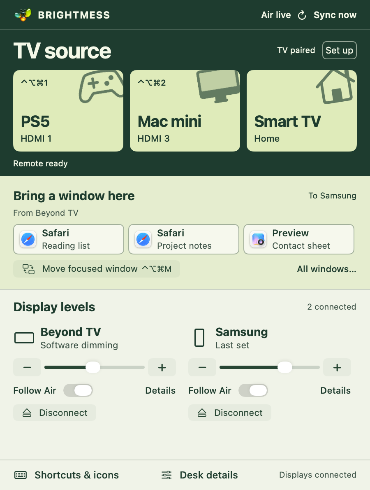

# BRIGHTMESS

BRIGHTMESS is a native macOS menu-bar app for a desk with more than one
screen. Its **Source Deck** popover lets you follow a MacBook Air's brightness,
bring a Mac window to the monitor in front of you, or change what a paired TV
is showing. Moving a window never switches the TV input, and changing the TV
input never moves a window.

**On the tested 43-inch iFFALCON TCL G07:** click **Smart TV** for Home or
**Mac mini** for its assigned HDMI port. Home and the original HDMI 3 route
were physically confirmed. After the 4 November desk reshuffle, this Mini is
configured for **Mac mini → HDMI 1** and **PS5 → HDMI 2**. Those new picture
changes still need user confirmation. No USB debugging or TV-side app is
needed. See the [current mapping record](research/TCL-REMAP-0.11.1.md).

[Source Deck controls](#menu-bar-controls) · [Install](#install) ·
[TCL setup and field notes](research/LIGHT-DESK-0.9.md#verified-return-to-hdmi-3-over-wi-fi) ·
[Release history](CHANGELOG.md)

**0.12.3 (Mini build 26):** The window picker waits for macOS to finish
transitioning a window before moving it or reporting success. Terminal's
Samsung-to-TV move was confirmed on the installed build. See the
[verification record](research/WINDOW-TRANSITIONS-0.12.3.md).

## Menu-bar controls

Click the two glass screens in the menu bar to open **Source Deck** (Mini 0.12.3,
build 26). TV sources come first, then windows from your other display, then
independent display controls. The small display shapes use macOS desktop
proportions; they do not claim a panel's physical size or native resolution.
Click the shape or **Details** for readings and calibration. No Air update is needed.

[Out of Register](Assets/Brand/README.md) pairs a wide TV with a portrait monitor:
one shared lime stripe, one amber pixel out of place. [See the actual-size menu
mark](docs/brand-icons-1x.png), including solar and attention on light and dark bars.



**Bring a window here:** Open the menu on Samsung and click an app icon and
window title under **From Beyond TV**. Open it on the TV to bring windows
from Samsung instead. The shelf doesn't depend on which app was focused.
**All windows…** expands the list; **Move focused window** remains a separate
action. Moving one window doesn't switch the TV input. macOS must still
see both displays; if switching HDMI makes it relocate a window, the shelf
uses the current layout. Only movable, non-minimized, non-full-screen standard
windows are offered. Accessibility is required, not Screen Recording.

When available, WindowServer geometry is matched by exact window ID and owner
to correct stale Accessibility positions. Moves recheck the same window rather
than matching app names or equal-sized browser windows. See the
[geometry fix](research/WINDOW-GEOMETRY-0.12.2.md).

**Shortcuts & icons:** click this control at the bottom of Source Deck. Click
an action's symbol to change its icon, or click its key field to record a new
combination. Esc cancels; × clears only that action. **Use suggested keys**
fills unassigned actions without overwriting existing shortcuts:

| Keys (Control + Option + Command) | Action |
| --- | --- |
| ⌃⌥⌘M | Move the focused Mac window to the other connected display. Press again to move it back. |
| ⌃⌥⌘1 | Select the TV's configured PS5 input (now HDMI 2 on this desk). This does not power on the PS5. |
| ⌃⌥⌘2 | Select the TV's configured Mac mini input (now HDMI 1 on this desk). |

Smart TV Home stays a clickable button with a configurable icon, not a
global shortcut. The three shortcuts work with the menu closed. An active TV
shortcut keeps only the paired remote session available; a shortcut pressed
while disconnected is not queued. No Spotlight setting changes.
See the [shortcut editor preview](docs/shortcuts-and-icons.png).

**Switch TV inputs:** With the Mini and TV on the same LAN, choose **Pair
TV** on the TV card, select the TV, and enter its on-screen code into
BRIGHTMESS. Allow Local Network discovery if macOS asks. For a known input
ID, open **Set up → Configure TV inputs…**, choose the port for each device,
enter its **full** ID when a saved one is unavailable, turn **uses input
chooser** off for that button, and save. A selected port uses its saved ID
on this paired TV; do not copy another model's ID. Buttons, captions and
shortcuts follow the assignment. Saving does not switch inputs.
On our G07, the TV's MagiConnect service supplied the ID over Wi-Fi; the
already-paired Android TV remote connection sent the input link. Automatic
discovery of port IDs and attached-device identities is **not** part of this
release; the current TCL catalog was read during desk setup. Moving a cable
does not automatically identify a PS5. A button with an ellipsis
requests the TV's input menu instead; this TCL ignored that request. See the
[tested mapping](research/LIGHT-DESK-0.9.md#verified-return-to-hdmi-3-over-wi-fi)
before trying any fallback. **Command sent** is not readback of the active
input, and commands are never queued for an offline TV.

**TV code setup is still available:** open **Set up → Pair again with TV
code**, look at the physical TV, enter its six-character code into the app,
and choose **Verify**. **Cancel** keeps the saved pairing. Do not paste codes
into chat. If discovery finds no TV, expand **TV not found? Use its network
address**, enter the TV's local IPv4 address from its Network settings, then
choose the code button. The address alone never replaces the code proof.

**Pairing saved** means stored credentials, not a live connection. **TV
connected** appears only after an authenticated remote handshake. Reconnect
tries the last authenticated address even if Bonjour is missing, then bounded
TCL LAN discovery for a changed address. Candidates must match the saved TV
key. Some networks block broadcasts; use the address escape hatch rather than
resetting pairing blindly. The optional LAN probe locates TVs, not the devices
plugged into their HDMI ports. [Recovery verification](research/TV-RECOVERY-0.11.2.md).

TV setup actions use explicit cream text and outlined button plates on the
forest panel. The TV band's native fields, HDMI selectors and disclosure
indicators keep a readable dark control palette in either macOS appearance.

The panel provides:

- an independent brightness slider and **− / +** buttons for each connected display; unlike keyboard keys, these buttons adjust only that screen;
- **Follow Air** per display; dragging a slider changes only that display
  without disabling automatic following; an explicit off switch stays manual;
- **Disconnect / Reconnect** per display;
- **Reconnect all** when there is a disconnected screen; the last connected screen cannot be disconnected;
- **Off / Adaptive / Manual white balance**, strength, trim and calibration under each screen’s **Details**;
- automatic per-screen learning, Undo last match and confirmed Reset calibration;
- Magic Keyboard brightness keys (Accessibility permission required);
- **Desk details** for source readings, keyboard status, re-detection, and the receiver log;
- source status for MacBook Air or solar fallback;
- on-demand Air sync and receiver-log access.

Automatic updates never overwrite a display left in manual mode. Re-enabling
**Follow Air** applies the current source value immediately.

## Current two-display behavior

This machine has been probed per display rather than treating every DDC service
as one monitor:

| Display | Stable identity | Brightness path | Displayed reading | macOS layout action |
|---|---|---|---|---|
| Samsung `LU28R55` (portrait) | EDID `4C2D1610-…` | Targeted hardware DDC | Measured percentage and reading age; last command/older reading when not fresh | Disconnect/reconnect |
| iFFALCON TCL 43-inch 4K (`Beyond TV` in macOS) | EDID `63185128-…` | Per-screen software dimming; DDC read/write rejected | `Software live` | Disconnect/reconnect |

The distinction is deliberate. A cached command is never presented as a live
hardware read. The TV's software value is live because BRIGHTMESS owns
the shade opacity. Earlier builds sent a malformed GET-VCP checksum, so their
Samsung **Last set** label was not evidence that the monitor lacked readback.
Build 16 fixes that request and checks reply framing, result, VCP code and
checksum. A reading is fresh for at most 15 seconds and must follow the latest
write. The app reads after a settled hardware change and, while the menu is
open, at most every five seconds (30-second backoff on failure). It does not
poll a settled display while the menu is closed. The TV shade dims the
**Mac desktop** on that display; it does
not change the TV's physical backlight or dim a PS5 game or built-in TV app.

**Disconnect** removes a screen from the macOS layout for this login session.
Its card remains available for **Reconnect**. The last active screen cannot be
disconnected. A recovery ledger is saved before the operation; restarting the
app or running recover-displays reconnects recorded screens. Logical disconnect
does not promise electrical power-off.

Reconnect resolution distinguishes a current display endpoint from cached
WindowServer slots, including slots with the same vendor/model/serial. A
genuinely ambiguous match is refused before changing a screen. When a cable
replug restores a known display, BRIGHTMESS clears the old connection error
and reapplies its automatic or manual level once. If macOS still rejects
reattachment, check the monitor's selected input and cable, then disconnect
its power for 20 seconds before reconnecting; do not reset all display settings.
See the [recovery fix and verification boundary](research/DISPLAY-RECOVERY-0.10.3.md).

### Bring a window here with the keyboard

Press **Control + Option + Space**, release the modifiers, then press the letter
shown beside an app. One eligible window comes directly; multiple windows open
numbered choices. Use **Up / Down + Return**, **/** to search, or **Escape** to
back out. **Left / Right** changes destination outside search mode. The heading
always names where the window will go; the initial destination is the display
under the pointer, not the stranded window's display.

You can also choose **Open window picker** in the window shelf, or change/clear
its global binding under **Shortcuts & icons**. The new default is offered only
once and only if the system registration succeeds; existing bindings are not
overwritten. VoiceOver users should choose a chord that does not conflict with
their VoiceOver commands. Ordinary app-local shortcut conflicts may still need
a different binding even when system registration succeeds.

The picker requires Accessibility. It keeps exact window identities and stable
key mappings during each open session. Unsupported windows explain their
limitation; refresh after a window closes or a display changes. No window move
sends a TV input command, so retrieval does not deliberately interrupt PS5.

Supported full-screen windows are labeled before selection. BRIGHTMESS requests
exit for that window, waits for it to settle, then fits and moves it. Apps that
do not expose this control, and partial-display full-screen layouts, require
manual exit. Escape stops further steps; an exit or move already sent may finish.
This is not a universal full-screen or Split View compatibility claim.

During a Space animation, macOS can briefly omit a window's position or return
its animation size. The picker retries those reads while opening or moving,
waits for stable geometry, and verifies the destination before reporting success.
It never repeats a move, substitutes another window, or polls while idle. If the
position is still unavailable, let the transition finish and refresh the choices.

### Samsung sources: qualify before enabling

Open **Sources** on the Samsung card. **Read input** measures VCP 0x60;
reading the DisplayPort code is not a verified HDMI round trip. Each port's
menu lets you change its device name, inspect its advanced DDC mapping, and
record an optional shortcut. Samsung shortcuts start unassigned and do not
replace the TV's existing keys.

For HDMI 1 or HDMI 2, choose **Test round trip…** only after connecting an
awake video device, keeping a second Mac screen usable, and locating the
Samsung JOG control for manual DisplayPort recovery. The test requests HDMI,
then DisplayPort once. It enables that HDMI route only after return readback
and your confirmation that both physical pictures appeared without using the
JOG control. Changing its code clears verification; renaming it does not.

The conventional candidate codes 17 and 18 are **not qualified on this unit**.
Its advertised source list conflicts with the measured DisplayPort code 15.
No input change is queued after a failure; an uncertain send explicitly says
the current picture is unknown. Source selection never disconnects a Mac
display or changes the TCL input. Contrast, RGB, standby and PIP/PBP remain
outside this release. [Research and acceptance record](research/SAMSUNG-CONTROL-0.11.0.md).

Automatic mode follows the final brightness chosen by a reachable MacBook Air —
including macOS ambient-light decisions and your manual corrections. The Air
sends changed values live over Tailscale. A 60-second heartbeat keeps a quiet
Air fresh; Sync Now still works. The Mini holds the last level for five minutes
on loss, then uses solar fallback. Legacy scheduled helpers retain their longer
freshness window.

The relay reads ambient lux and colour temperature from the Air, then computes
its own True-Tone-like correction for each screen. It does not copy Apple's
complete internal True Tone transformation. Colour starts Off per display.

**Verified on the two-Mac desk, 2 November 2026:** changing brightness on the
M2 Air made the Mini's displays follow without **Sync Now**. The tester described
the response as almost immediate. The receiver logged Samsung DDC settings down
to 20% and back to 100%; the TV followed through software dimming. This was a
physical responsiveness check, not a timed latency measurement. See the
[0.8 verification record](research/IMPLEMENTATION-0.8.0.md) for test results,
CPU measurements and checks that remain open.

## White balance and calibration

The Air must be awake and open and is trusted whenever reachable, regardless of
location. Live mode listens for built-in brightness notifications and uses a
two-second watchdog and cached ambient sensor. Only material changes, Sync Now,
lifecycle events and a 60-second heartbeat are sent. One request is in flight;
the newest pending sample wins. No DDC writes are needed on a steady input.
Use `source --sync-mode scheduled --interval 1800` for the old schedule.

Each monitor resolves its own EDID primaries and baseline colour table.
Unknown primaries use a labelled sRGB estimate. Adaptive corrections ease toward
the new target. Missing, closed-lid, too-dark and expired readings restore the
owned baseline. Live colour expires after 90 seconds; scheduled colour expires after 45 minutes. The menu distinguishes
an old Air helper from an unavailable sensor.

Manual white balance accepts 3500–7500 K targets. Reset restores the baseline.
Colour pauses during active HDR or interference from another colour-control
app. API readback verifies the table, not physical colour accuracy.

With Follow automatic on, adjust a screen to a comfortable level. Releasing
its slider, or finishing a group of keyboard presses, learns one match to the
fresh Air percentage and leaves Auto on. The newest match wins; other points
form a monotonic curve. No learning from stale input, solar fallback, fades
or reconnects. Undo/reset are independent per screen. "Mapped target" is not
a hardware measurement: Samsung labels a fresh DDC reading separately from the
last command, and the TV shows its applied software level. Optional Samsung
extra dimming applies only at hardware zero.

Keyboard keys adjust both connected displays. Plain keys use 6% steps; Option+Shift uses 1%. The menu's Enable button requests
Accessibility permission. Approve BRIGHTMESS in macOS settings.

Reused components include TrueTone's colour/calibration maths, LuxCurve filtering
and MediaKeyTap. MonitorControl, mac-utils, LumenShift, ddc-mirror and LunarSensor
provided architecture references. No encrypted Lunar code or competing apps are
bundled. See [NOTICE](NOTICE) and the [research revisions](research/repos.lock.json).

## Architecture

```text
MacBook ambient-light / automatic brightness
        ↓
DisplayServices brightness sample (0...1)
        ↓  HMAC-SHA256 authenticated Tailscale request
Mac mini receiver + per-display coordinator
        ├─ Samsung LU28R55 → targeted DDC VCP 0x10
        └─ Beyond TV      → per-screen software shade

Live Air unavailable for 5 minutes
        ↓
SunKit solar elevation, refreshed every 5 minutes
        ↓
Same per-display automatic/manual policy
```

Display routing is keyed by EDID identity, not enumeration order. The native
transport reuses the per-display `IODisplayLocation` →
`IOMobileFramebuffer` → `DCPAVServiceProxy` mapping and MCDP29xx HDMI handling
from [m1ddc](https://github.com/waydabber/m1ddc). DDC packet handling,
serialization, and the software-shade approach follow
[MonitorControl](https://github.com/MonitorControl/MonitorControl). Both are
MIT-licensed and attributed in [NOTICE](NOTICE).

TV pairing and window movement do not use the Air relay. The Mini keeps its
TV client identity in Keychain and pins the TV's public key. Window moves
run locally using Accessibility; window titles are neither logged nor sent
to the Air or TV.

The relay sends no screen content, sensor history, or Apple-account data. A
shared 256-bit token authenticates updates, pull requests, and recovery
controls. Packets older than 30 seconds and repeated nonces are rejected.

## Install

On the Mac mini (macOS 14 or newer, with the Swift toolchain installed),
configure an available Apple code-signing identity before installing. Set
`BR_SIGNING_IDENTITY` to its exact certificate fingerprint, or save that
fingerprint in `~/.config/brightness-relay/signing-identity`. The installer
checks certificate trust and revocation, and preserves the installed app's
signing identity across updates. See [signing and recovery](#signing-and-permissions).

```sh
# From the repository root:
./scripts/install-mini.sh
```

The installer builds and installs `~/Applications/BRIGHTMESS.app`, then
restarts its LaunchAgent. When upgrading from the older **Brightness Relay**
bundle, it backs up the app and migrates the launch path without replacing
pairing, display settings, or other receiver arguments. The CLI, LaunchAgent
labels, and Application Support directory keep their original names.

**Already syncing from a 0.8 Air?** There is nothing to install there for the
new Mini controls. For a first-time Air installation, privately copy the Mini's token to
`~/.config/brightness-relay/token` on the Air, then run:

```sh
./scripts/install-air.sh "<Mini Tailscale IP or hostname>"
```

Or create the private AirDrop bundle:

```sh
./scripts/create-air-bundle.sh
```

Keep **Automatically adjust brightness** enabled on the Air. The Air source
runs in live mode while that user is logged in and keeps an outbound
long-poll open for **Sync Now**.

The default fallback is configured for the sample desk in `Asia/Kolkata`.
Set the Mini LaunchAgent's latitude, longitude and timezone for your desk.

## Diagnostics and recovery

```sh
brightness-relay displays
brightness-relay probe
brightness-relay set-display 1 50
brightness-relay wake-all
brightness-relay show-menu
```

`displays` shows stable identities and advertised standby support. `probe`
attempts read-only live DDC reads. `set-display` targets one display; it will
fail honestly for a monitor that rejects DDC instead of claiming success.
`wake-all` asks the running app to reconnect known disconnected screens.
`show-menu` opens the controller without hunting for the status icon.

## Development

The current CLT SwiftBuild engine has duplicate platform specifications.
`scripts/swiftpm.sh` selects the native engine without modifying system files.

```sh
./scripts/swiftpm.sh build -c release
.build/release/brightness-self-test
BR_TEST_LOG="$(mktemp -t brightmess-sim)" ./scripts/swiftpm.sh run brightness-relay simulation-check
./scripts/swiftpm.sh test   # requires a toolchain with the Testing module
```

The self-test covers TV protocol framing and pairing, window movement, brightness/colour calibration,
sensor validity/expiry, backwards compatibility, authenticated and replay-safe
packets, keyboard steps and disconnect policy. The Swift Testing suite remains
under Tests/; select a full Xcode toolchain when Command Line Tools lacks Testing.

The Mini's bundle version is **0.12.3**, while the compatible receiver API
still reports **0.8.0**. In `status`, check `controls.uiBuild` for the Mini
build (`26`), and `sourceMode` for the Air's mode. Examples:

```sh
brightness-relay status --host 127.0.0.1
brightness-relay sync-now --host 127.0.0.1
brightness-relay sensor-sample                 # on the Air
brightness-relay send-sample --host "<Mini Tailscale IP or hostname>"
brightness-relay recover-displays
zsh scripts/package-air-update.sh
```

### Signing and permissions

The Mini installer backs up the old app and preserves receiver arguments.
Configure the exact signing-certificate fingerprint through `BR_SIGNING_IDENTITY`
or `~/.config/brightness-relay/signing-identity`. Each install requires a successful
code-signing trust and online revocation check. It never auto-picks a certificate
or silently falls back to ad-hoc signing; `-` is allowed only with `--stage-only`.
After migration, a new build must also satisfy the installed app's designated
signing requirement. Verification failure leaves the installed app unchanged.

The one-time move from ad-hoc to stable signing can require Accessibility
approval for `~/Applications/BRIGHTMESS.app` and Keychain authorization for its
existing TV key. Choose Always Allow in that specific system prompt if you want
matching signed updates to reuse the key. No private key is exported by the app,
no Keychain ACL is programmatically widened, and no Gatekeeper setting is disabled.
This is a local development build; public notarized distribution is separate.

The TV certificate is found through the tagged key's public-key hash, not its
display label. Reconnect never generates a replacement certificate. Pair again
is the explicit code-based repair route; it preserves the old pairing until
verification. A blocked Keychain request times out with guidance rather than
keeping the setup permanently busy.

If the entry is on but the app still reports missing access, reset **only this
app's Accessibility approval** on the Mini and request it again:

```sh
tccutil reset Accessibility dev.pranav.BrightnessRelay &&
  "$HOME/.local/bin/brightness-relay" enable-keys --host 127.0.0.1
```

Approve the installed Mini app, then check `brightness-relay status --host
127.0.0.1` for **Keyboard brightness keys ready**. Keyboard permission is not
required for the Air to send readings.

Historical 0.7 integration evidence:
[research/IMPLEMENTATION-0.7.0.md](research/IMPLEMENTATION-0.7.0.md).

The private Air update ZIP in Downloads contains the pairing token. Transfer it
only to your Air, then run the enclosed installer. Its helper lives in
Application Support rather than depending on the previously missing local-bin
executable. Existing brightness-only helpers remain compatible, but cannot
supply colour readings until updated.

The DDC transport uses private-but-local macOS display services because Apple
does not expose external DDC control through a supported public API. This is a
local passion project, not a Mac App Store target.

## Recovery and release records

The debug-only simulation above uses a loopback receiver, fake displays and
isolated preferences. It is not a physical TV or keyboard test. Use
`zsh scripts/measure-relay.sh mini` or `air` for a ten-minute CPU sample.

If upgrading an older Air helper to live sync, install the Mini first, run
`zsh scripts/package-air-update.sh`, and privately copy the resulting ZIP
to the Air. Skip this for an already-working 0.8 Air. Both installers keep backups in
`~/Library/Application Support/Brightness Relay/Backups/`. Run the appropriate
rollback command **from its backup folder** to restore the previous helper
and LaunchAgent. The Air installer verifies a new live session, not merely a
successful copy or scheduled packet. An upgrade from an older ad-hoc Mini build
can require re-adding the installed app in macOS Accessibility settings once.

A separate physical desk sensor is not implemented. Solar fallback estimates
brightness only and never invents an ambient colour reading.

See the [release history](CHANGELOG.md) for the per-version verification
records and the [product brief](PRODUCT.md) for the design and compatibility rules.
