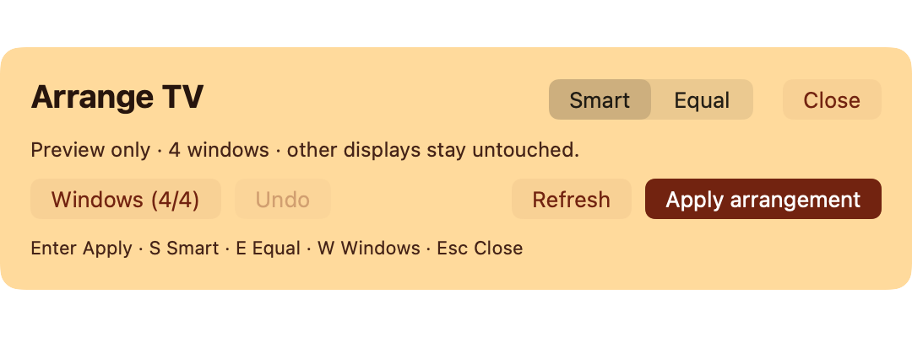

# Window reliability and quick Apply · 0.14.1 / build 33

Status on 16 November 2026: **signed candidate staged, not installed**.
The development Mini still runs build 32. This update needs no Air helper or
protocol change. Installation requires explicit approval, a rollback backup,
and a fresh check for an in-memory Arrange Undo before restarting.

On 16 November the user reported that both Bring Here and Arrange worked in
their hands-on check. Follow-up inspection still found installed build 32;
the tested session was not independently tied to the candidate executable.
Record this as user-confirmed workflow success, not proof of build-33 rollout.

## What changes

Bring Here, focused/shelf moves and Arrange share one short serialized native
frame writer. AppKit enhanced accessibility animation could accept a resize
but drop the position, leaving a window on its original display. Only during
the size/position/size batch, the writer temporarily disables that app's
enhanced-UI flag when it was enabled, then verifies restoration. It does not
change this flag while VoiceOver or Switch Control is active. Unknown/disabled
initial states are preserved. Exact owner/window identity, permission and
cancellation checks remain; no failed move is automatically replayed.

The native fixture exposed an important API detail: an enhanced-UI setter
returned `kAXErrorNotImplemented` (-25208) even though subsequent readback
showed the requested value. The adapter now requires positive value readback
for both disable and restore rather than trusting the setter's return code.
If restoration cannot be verified, the operation reports an error.

Arrange opens with all eligible windows selected. Release the opening
Control-Option-Return chord, then press a fresh Enter/keypad Enter to apply.
Apply receives initial focus, but Enter also works from the layout controls.
S chooses Smart, E Equal, W opens the checklist, Escape closes/stops, and
Command-Z undoes. Tab and Space keep their ordinary control behavior. Loading,
empty or infeasible previews cannot Apply; repeated key events do not queue work.

Only a complete verified Apply dismisses the panel. It restores the previous
external application only while BRIGHTMESS still owns focus; the pointer does
not move. Partial changes, errors and Undo results stay visible. Reopening
allows Undo, and an already-correct/no-op Apply preserves the last useful
recovery journal instead of erasing it.

## Evidence

| Layer | Result |
| --- | --- |
| Reproduction | Fake native animation reproduced resize-on-source and the exact reported display-confirmation error before the guard. |
| Regression | First-attempt retrieval passed with one frame batch; flag restoration, cancellation, identity change and active assistive tools covered. |
| Swift Testing | 78 cases passed with Xcode 27.2; the default CLT lacks the Testing module. |
| Core executable | 27 checks passed. |
| Expanded simulation | Arrange model/router, no-op Undo, window identity, TV mapping/identity/reconnect, display recovery, App Intent routing, live relay and transport checks passed. |
| Native keyboard panel, fake window driver | Apply initially focused; E/W worked; Enter applied once from the Equal control; success auto-closed; reopening and Command-Z restored four simulated windows. Repeated identical Apply preserved all four Undo entries. |
| Native disposable AppKit window | Tall Samsung → TV; wide TV → Samsung; maximized Samsung → TV; true full-screen TV → Samsung all completed in the first frame batch. Original native identity and enhanced-UI state were retained. |
| Render review | Light/dark and expanded native control fixtures reviewed; key legend and existing controls visible. |
| Packaging | Release compilation, all three App Intents metadata, configured certificate trust/revocation, strict signature and installed signing-requirement continuity passed. |

The native geometry check used the dedicated `BRMMoveFixture` window only.
It observed the final destination and fitted frame, not merely an accepted AX
write. Personal windows were not moved, and no TV-source commands were sent.
The simulation deliberately uses loopback connection failures for recovery
tests; those expected errors are not failures of the running TV session.

### Native fixture controls



[Dark controls](window-reliability/quick-apply-dark.png) ·
[Expanded window choices](window-reliability/expanded-light.png)

These PNGs were rendered on 16 November 2026 by the native Arrange view with
synthetic app/window labels and fake displays. They contain no personal
window titles and are not installed-app or physical-keyboard acceptance.

### Reproduce the automated checks

Use `DEVELOPER_DIR=/Applications/Xcode_27.2.app/Contents/Developer` for the
following commands on this development machine:

```sh
scripts/swiftpm.sh test --scratch-path .build/feature-tests
.build/feature-tests/debug/brightness-self-test
.build/feature-tests/debug/brightness-relay simulation-check
scripts/prepare-window-fixtures.sh
```

The fixture preparation script builds but does not launch or move windows.
The generated Arrange fixture app uses a fake display driver; real native
`window-fixture-move` refuses to operate without the exact owned fixture.
Never use personal windows as unattended test targets.

## Candidate and rollout gate

Staged bundle, relative to the repository:
`.build/xcode-tests/mini-preview.J9xPuy/BRIGHTMESS.app`.

Version/build: **0.14.1 / 33**. Bundle identifier remains
`dev.pranav.BrightnessRelay`. Apple Development signed, matching the installed
identity; this is **not** a notarized public distribution.

Candidate executable SHA-256:
`b88037e9301344d557d68a34060edbe2fe7622c82fc96e6a3f4f4593b40cf430`.

Unchanged installed build-32 executable SHA-256:
`c34b6797be3de147ce92440875496f7ce9684320d5337bb99493ecbaafa2844e`.

Read-only post-stage status still reported build 32, Air Live (reading age
under five seconds), authenticated TV readiness and Accessibility access.
No saved Arrange Undo was reported at that check; recheck immediately before
any approved installation because it is runtime state.

Pending after approval and installation: the actual ChatGPT-window first-try
transfer; physical global Arrange chord/release/Enter; real Arrange/Undo on
disposable windows using the installed receiver; permission/TV/Air checks
after replacement. Neither fake-driver success nor a disposable AppKit
round trip proves every third-party app's behavior.

The exploratory mouse-cycle feature is deliberately excluded. No Logitech
Flow, Universal Control, Magic Keyboard, pointer speed or Wispr mappings were
changed. No new background scanner, window polling service or global shortcut
was added by this patch.
