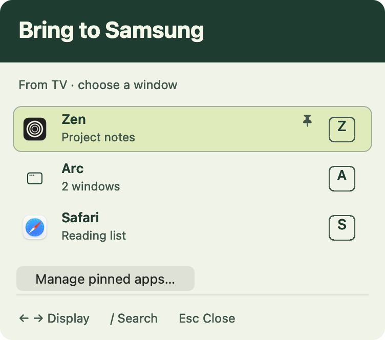
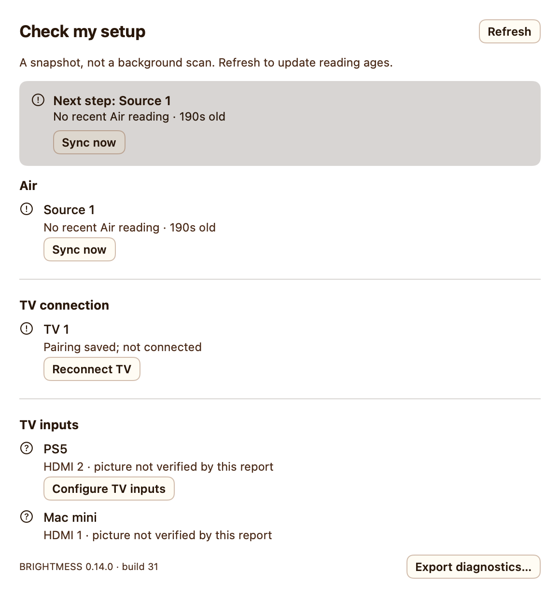

# Faster access and setup checks · 0.14 / build 32

This Mini-only update is installed on the development desk after explicit
approval. The Air remains compatible without an update. Existing preferences
were compared semantically, including encoded JSON values: no existing key
changed, and the new pin list was the only added key. The LaunchAgent matched
its pre-update backup. No TV source command was sent during rollout.

## Bring Here

The first-run pins are Aside, Codex, Terminal, Zen and Finder. Pins use bundle
identifiers and survive renames/restarts; deleting the last pin does not reset
the defaults. Manage pinned apps (also Command–Comma in the picker) supports
reorder, removal and adding running or installed applications.

Only windows on other displays are eligible. Pinned apps lead; recent
successful BRIGHTMESS retrievals come next; remaining apps sort alphabetically.
Recent windows are limited to 20 process-start/native-window identities in
memory. No titles or usage history are persisted. A new open takes a frozen
inventory; editing preferences cannot reshuffle keys underneath the user.
Initial collisions remain grouped and exact windows retain numbered choices.

## macOS Shortcuts

- **Open Bring Here:** capture the pointer display, open the picker; does not move a window.
- **Preview arrangement here:** open the existing preview; Apply is still explicit.
- **Select TV source:** choose PS5, Mac mini or Smart TV using the saved mapping.

Actions route through the existing running panels and authenticated remote.
No additional network service or remote session is created. Unavailable TV
commands are not queued. Success says Command sent, not that the physical
picture changed. A bounded send timeout reports uncertain delivery and never
replays the action. Existing keyboard shortcuts are unchanged.

In the native build-31 test, Shortcuts' Show When Run dialog competed with the
picker. Build 32 returns string values instead of ProvidesDialog results. All
three actions appeared in the real Shortcuts search, and Open Bring Here
completed with “Picker opened”. A ready-made **BRIGHTMESS — Bring Here**
shortcut was retained in the user's library. UI-opening actions return when
the panel opens, not when a window is selected or an arrangement is applied;
put them last in a workflow if a later action would steal focus.

Bundle packaging requires full Xcode's App Intents metadata processor. The
same-module constant extraction produces Metadata.appintents and fails staging
unless all three action identifiers are present. Cold bundle launches adopt
the existing receiver LaunchAgent's menu arguments; bare CLI invocation retains
its command-required behavior. Cold-launch execution remains unverified on
the installed app; do not infer it from successful warm execution.

## Check my setup and export

Desk details → Check my setup opens a snapshot with Air, TV connection, input
mapping, permission and display sections. Refresh takes another snapshot; it
does not probe hardware or poll the network. The first actionable issue gets
a suggested next step. Recovery occurs only after clicking its named action.

Saved pairing is distinct from authenticated connection. A timeout is not
evidence of denied Local Network permission. Input mapping is shown separately
from picture verification, which this read-only report cannot establish.

[Dark report fixture](workflows/setup-dark.png).

Export diagnostics freezes a version-1 JSON preview and opens a native save
dialog. Its schema allows build/version, relative age, status/error codes,
report-local display aliases and fixed performance counters. It excludes raw
logs/status, secrets, certificate/key data, hostnames/addresses, paths, serials,
session/device IDs, app usage history and personal window titles. Nothing uploads.

## Performance and verification

- Pre-update build 30: **0.829% of one CPU core over 601 seconds** (4.98 CPU
  seconds). The prior measurement script supplied CPU-only data; this is not a
  controlled new-build acceptance result or an Air measurement.
- Installed build 32: **1.0207% of one CPU core over 601.55 seconds**. The
  under-1% target was **not met** in this run. Counter deltas: 40 accepted Air
  samples, 65 application requests/responses, 0 hardware brightness writes,
  0 hardware read attempts, 49 software writes and 120 TV protocol messages.
  Two status requests belong to the measurement itself. This was not a
  steady-target/heartbeat-only run; the picker was open at the starting check.
  Do not claim a controlled idle regression pass from these numbers. A quiet
  repeat with stable source readings remains pending.
- New measurement: `zsh scripts/measure-relay.sh mini` (or `air`). Runs ten
  minutes on demand, validates the same process, rejects sleep/clock changes,
  and prints CPU plus available counter deltas. It makes two status requests
  for Mini measurement, separately identified in the output.
- Network counts mean application requests/messages, not packets. Accepted
  samples are receiver observations, not a direct count of all sender attempts.
  Document brightness/sensor/user activity when interpreting a run.
- Tests protect heartbeat-only quiet sampling, latest-value coalescing,
  bounded retries, final-value delivery and zero settled DDC writes.
- Full Swift Testing suite, executable core checks and real-logic fake-device
  simulation are run independently of physical acceptance. The CLT lacks
  `Testing`; full Xcode is used instead.

Validated on 6 November 2026: **70 Swift Testing cases**, **27 core executable
checks**, and the expanded simulation including the three App Intent routes,
missing destination, denied access and offline-TV refusal. Release compilation,
three-action metadata extraction, certificate trust/revocation verification,
strict bundle signature verification and predecessor signing-requirement
compatibility passed. An initial certificate trust check failed transiently;
the same configured certificate later passed without bypass or replacement.
This is a local Apple Development-signed build, not a notarized public release.

Installed bundle: `~/Applications/BRIGHTMESS.app`, build 32.
Executable SHA-256: `c34b6797be3de147ce92440875496f7ce9684320d5337bb99493ecbaafa2844e`.
Air Live, authenticated TV readiness, Accessibility and Magic Keyboard handler
readiness were verified after both restarts; no reapproval was needed. No
Arrange Undo was saved before either restart.

Rollback to build 30: `~/Library/Application Support/Brightness Relay/Backups/20261106-163519.rv2lLQ/Rollback Mini.command`.
Build-31 intermediate backup: `~/Library/Application Support/Brightness Relay/Backups/20261106-164314.29G9pX/`.
Preference/LaunchAgent preflight backup: `~/Library/Application Support/Brightness Relay/Backups/Workflow31-preflight.Es5Q4y/`.
Performance measurement scripts require the Swift command-line runtime; this
does not add a runtime dependency to the app itself.

The installed pin manager displayed all five defaults in the intended order.
One successful move was recorded during the picker trial, but the user was
unsure whether they selected it; it is **not counted** as a verified disposable
transfer test, and the agent did not reposition the window afterward.

Still unverified on this build: cold-launch Shortcuts execution; native Arrange
intent and TV-source intent execution; disposable-window round trip/Arrange
Undo; physical TV picture and physical Magic Keyboard events. The computer-use
adapter repeatedly selected the full-screen shade window instead of Source
Deck, so report/export interaction has fixture and source proof, not installed
UI acceptance. Do not infer these outcomes from metadata or ready-state flags.

## Fixture provenance

Images are generated by the production native picker/report code with synthetic
window titles and fake device state on 6 November 2026. They contain no personal
desktop captures. `picker-preview` renders 18 picker states; `workflow-preview`
renders ready/attention reports in light/dark appearances. The documentation
includes representative captures only. They prove rendering, not installed or
physical operation.
